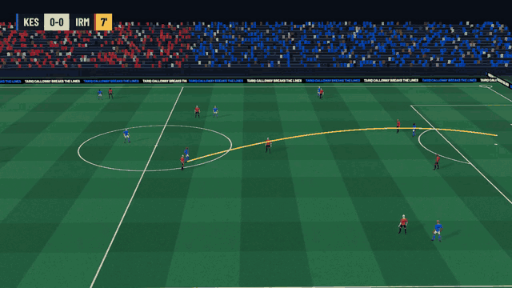
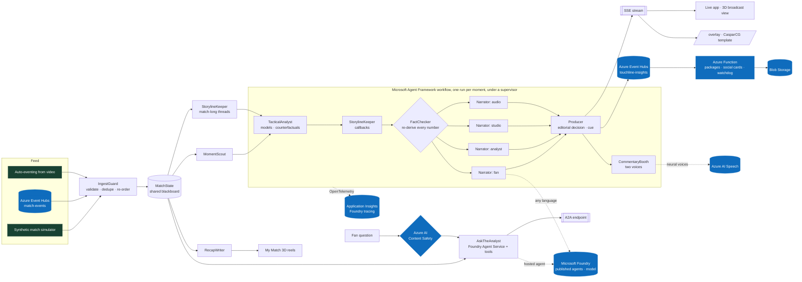

<div align="center">


# Touchline

**The game, explained.**

Multi-agent AI that turns a live football event feed into explained moments, match-long storylines,
broadcast graphics, two-voice commentary and a personal 3D highlights reel for every fan.
Every number is checked before it airs.

[](https://github.com/likalight/touchline/actions/workflows/ci.yml)
[](LICENSE)


[Quick start](#quick-start) · [Deploy](#deploy-to-azure) · [How it works](#how-it-works) · [Evaluation](#evaluation) · [Docs](#documentation)



</div>

> Built for the Microsoft x Premier League *Inside the Game: Developer Hackathon*. All data is synthetic; the clubs, players and venue are fictional.

## Why Touchline

Graphics on a live broadcast say *what* happened. Working out *why it mattered*, correctly and in time, is still done by hand, and every viewer gets the same version of the story. Touchline gives that job to a team of AI agents:

- **Explains, not just counts.** Why a chance was big, which pass broke the press, how a red card changed the odds, and callbacks across the whole match ("redemption for Varga").
- **Never makes things up.** A fact-checker agent re-derives every number from the raw events; 735 of 735 insights verified in evaluation.
- **Made for every fan.** Four voices for each moment (fan, analyst, studio, audio description), any language, your clubs, your players, your metric.
- **Ready for a broadcast truck.** Timed overlay cues, a CasparCG/SPX template, an editorial producer agent with human approval, and an audit trail of every decision.


## Features

<table>
<tr>
<td width="50%" valign="top">

**Live intelligence**
- xG, expected threat, pass difficulty, PPDA, momentum, control vs chaos, rhythm, win probability
- Player tags with sprint thresholds, ball and shot speed
- Auto-eventing from video (top-down and broadcast camera)
- Storylines with match-long memory and callbacks

</td>
<td width="50%" valign="top">

**Agents that decide and check**
- Microsoft Agent Framework workflow with fan-out, fan-in and a supervisor
- FactChecker blocks any unsupported number or name
- Producer agent airs, cuts in, queues or drops each graphic, with reasons
- Resilience drills: break the feed, the model or an agent, live

</td>
</tr>
<tr>
<td valign="top">

**For fans**
- 3D broadcast view, isolated player cam, goal replays
- Fan, Analyst, Studio and Audio description views
- Favourite clubs and players, one-metric mode, any language
- Two-voice captioned commentary, Ask the analyst, 3D My Match reels

</td>
<td valign="top">

**On Azure, ready for production**
- Agents published to Microsoft Foundry Agent Service, with tracing and evaluations
- Azure AI Content Safety, Microsoft Entra ID roles, managed identity, no API keys
- Event Hubs in and out, Azure Functions back office, Container Apps
- One command: `azd up`

</td>
</tr>
</table>

## Quick start

```bash
git clone https://github.com/likalight/touchline && cd touchline
pip install -r requirements.txt
uvicorn touchline.server:app --reload       # open http://localhost:8000
```

It runs fully offline on verified phrase banks and your browser's voice; no keys needed.
Or skip the setup: [](https://codespaces.new/likalight/touchline)

**With Docker:** `docker build -t touchline . && docker run -p 8000:8000 touchline`

**Turn on the cloud agents** (optional):

```bash
export FOUNDRY_PROJECT_ENDPOINT=https://<resource>.services.ai.azure.com/api/projects/<project> FOUNDRY_MODEL=gpt-4.1-mini
export AZURE_SPEECH_REGION=<region> AZURE_SPEECH_KEY=...          # neural voices
```

| Page | What it is |
|---|---|
| `/` | The live app: 3D broadcast view, insight feed, producer console, agents at work |
| `/reel` | A personal 3D highlights reel, recorded in the browser |
| `/story` | The project page |
| `/overlay` | Keyable graphics output for a vision mixer |

## Deploy to Azure

```bash
azd auth login
azd up            # provisions everything in infra/ and deploys the container
```

[`infra/`](infra) (Bicep) provisions:

- **Azure Container Apps**, with HTTP autoscaling, sticky sessions, health probes and optional Entra ID authentication
- **Azure Container Registry**
- **Microsoft Foundry**: an AI Services account, a project with a tracing connection to Application Insights, and a `gpt-4.1-mini` deployment, with local auth disabled. The postprovision hook publishes the agents to **Foundry Agent Service**.
- **Azure AI Speech** and **Azure AI Content Safety**, through the same AI Services account
- **Azure Event Hubs**: `match-events` in, `touchline-insights` out
- **Azure Functions** (Flex Consumption) and **Blob Storage** for the event-driven back office
- **Log Analytics and Application Insights**
- a **user-assigned managed identity** with least-privilege roles

No API keys: services use the managed identity (the optional Entra sign-in client secret is the only secret, stored as a Container Apps secret). To require Microsoft sign-in for producer tools, run `./scripts/setup_entra.sh` after the first `azd up`. Event-driven mode: `python scripts/publish_feed.py --seed 42 --speed 10`
plays a match onto Event Hubs, and the app serves it as session `live` at `<url>/?session=live`.

## The demo match

The live demo replays match 221: **Kestrel Bay FC 3-2 Ironmoor Athletic**. Kestrel go down to ten
men in the 29th minute, fall behind, and sink to 2% win probability before Ravi Varga completes
his hat-trick in the 94th minute. Varga's own loss of possession had led to Ironmoor's first goal.
`scripts/find_demo_seed.py` found it by scoring 400 simulated matches for drama.

## How it works



<details>
<summary><b>The agents, and what makes this more than a chain of prompts</b></summary>

**Agents and their roles.**

| Agent | Role | Notes |
|---|---|---|
| `IngestGuard` | Front door for the feed | Pydantic contract, quarantine, exactly-once re-ordering, fault injection for demos |
| `MomentScout` | Decides what deserves airtime | Salience scores, cool-downs, sustained-pattern detectors (momentum, phase, pressing, rhythm) |
| `StorylineKeeper` | Match-long memory | Threads (duels, overloaded flanks, keepers, wasteful finishing, fatigue, costly errors, comebacks, ten men); writes callbacks; independently recounts its own numbers for the checker |
| `TacticalAnalyst` | Explains why it matters | Glass-box xG, pass and xT models; counterfactuals; evidence IDs on every claim |
| `FactChecker` | Nothing unverifiable airs | Recomputes every number from the raw events; blocks future citations; rejects LLM text with unsupported numbers or names |
| `Narrator` x4 | Persona- and language-specific copy | Verified phrase banks; optional Azure OpenAI rewrite or translation, always re-checked, delivered off the hot path |
| `Producer` | Editorial graphics director | Scores every moment and airs, cuts in, queues or drops it with a reason; review mode; `touchline.overlay/1` cues |
| `CommentaryBooth` | Two voices in the booth | A lead call (names only, no figures) plus the co-commentator's verified line, in four languages, spoken with two neural voices |
| Supervisor | Keeps the workflow alive | If a workflow run fails, rebuilds the graph and retries the moment once |
| `RecapWriter` | Half-time and full-time recaps | Story detection, turning points, the storylines that aired, standouts |
| `AskTheAnalyst` | Q&A for fans, producers and other agents | Published to **Foundry Agent Service** with six match-data tools; fan questions pass Content Safety Prompt Shields first; answers rejected if numbers aren't in a tool result; exposed over **A2A** |

**Multi-agent design: what makes it more than a chain of prompts.**

- **A real workflow graph.** Built with `WorkflowBuilder`: analyst, then storyline, then fact-checker, which **fans out** to four narrators in one superstep, which **fan in** to the producer. See `touchline/orchestrator.py`.
- **Memory that matters.** The StorylineKeeper carries state across the whole match, so commentary can call back to minute 36 in minute 76.
- **Agents that check each other.** The FactChecker found two real bugs during development. One was a comeback line citing an event from the future during fast replay. The other was a duel story that named two different players who shared a name. In both cases the insight was blocked instead of aired, and the root cause was fixed.
- **Agents that decide.** The Producer weighs moments against each other and against what is already on air, and says why it aired, cut in, queued or dropped each one (Producer console, *Editor's decisions*).
- **Failure recovery you can watch.** The *Resilience drills* panel breaks things on purpose while the match plays: a corrupted feed (IngestGuard repairs it), a model outage (circuit breaker, then phrase banks), a crashed narrator (a sibling's verified copy stands in), a crashed storyline agent (the moment airs without callbacks), and an injected made-up number (the FactChecker blocks it). Each shows which agent caught it and how long recovery took. Building the drills found a real gap, ordinals like "99th" slipping past the number check, which is now fixed and tested.
- **Contained language models.** LLM calls sit behind a timeout and a circuit breaker; a hosted Foundry agent falls back to the same agent run locally. Analysis runs in step with the feed, so it can never read the future, and slow language-model work arrives later as an update.
- **Observability.** Every handoff is a span: live in the *Agents at work* tab, exportable as an audit trail, and sent to Application Insights through OpenTelemetry with Agent Framework's own instrumentation.

</details>

## What it covers

<details>
<summary><b>Every stage and requirement of the challenge brief, mapped to the code</b></summary>

| Stage the brief asks for | What Touchline does |
|---|---|
| **Ingest** | A seeded, calibrated simulator generates a full 90-minute match (about 2.3 goals, 23 shots and 1,100 passes per game): passes, carries, dribbles, shots, saves, tackles, interceptions, pressures, fouls, cards and corners, with a 22-player tracking snapshot on every event. The `IngestGuard` validates, de-duplicates and re-orders the feed, and repaired a 10%-faulty feed exactly once in every evaluation match. The same pipeline consumes **Azure Event Hubs** or events **auto-generated from video**. |
| **Interpret** | `MatchState` keeps a live model of the match: possession, xG, expected threat (xT), pass difficulty, progressive and line-breaking passes, PPDA, momentum, **control vs chaos**, game rhythm, win probability (stoppage time included), player speed and distance, records and ratings. |
| **Explain** | The `TacticalAnalyst` says **why** a moment matters: which factor drove a chance, a **counterfactual** ("taken five metres closer, it would have gone in 67% of the time"), the assist's difficulty, the build-up's threat and the win-probability swing. The `StorylineKeeper` remembers the whole match and adds **callbacks**: "it began with a loss of possession by Varga, 24 seconds earlier", then later "redemption for Varga". Every claim cites event IDs, and the `FactChecker` re-derives every number, story counts included, before anything airs. |
| **Render** | The `Producer` agent is an editor: moments compete for the screen, and it scores each one (news value, storyline, freshness, team balance) and **airs, cuts in, queues or drops** it with a stated reason. It emits **timed, machine-readable cues** on the match clock (`touchline.overlay/1`), and a human producer can approve each one. The live app has a **3D broadcast view** (floodlit stadium, animated players in club kits, goal replays, an isolated player cam, LED boards carrying the verified insight), a keyable `/overlay` output, and a **CasparCG / SPX-compatible graphics template** that real playout systems can load. |
| **Personalise** | Every moment is written four ways: **Fan**, **Analyst**, **Studio** lower-third and **Audio description** for blind and low-vision fans, with a neural voice via Azure AI Speech. It works in **English, Spanish, French and Portuguese** offline, and in any language through Azure OpenAI. Viewers can pick **their club (or both)**, star **any number of favourite players**, switch on **player focus** to follow one player all match, or watch **one metric**. **Two-voice commentary** (a lead commentator and an analyst, captioned) speaks every key moment. After the match, **My Match** replays each fan's own highlights in the 3D stadium and records the reel in their browser: their clubs, their players, their language. |

Everything else in the brief is covered too:

- **Player identification:** live name tags with speed indicators past a 28 km/h sprint threshold.
- **Pass quality:** distance, accuracy, and a 0 to 100 difficulty rating from a trained model.
- **Ball and shot speed.**
- **Auto-eventing from video:** pass and speed metrics generated from pixels.
- **Narratives, milestones and recaps** that find the story: comeback, ten men, late winner, hat-trick.
- **Explainability:** control vs chaos, pressing changes and game rhythm.
- **Synthetic data innovation:** a downloadable dataset and a model card.
- **Multilingual storytelling.**

</details>

## Microsoft Foundry

- **Agents published to Foundry Agent Service.** `azd up` runs `scripts/foundry_publish.py`, which publishes `touchline-analyst` (with its six tools) and `touchline-narrator` as new versions tagged with the git commit, each with a Responsible-AI content policy. At runtime `FoundryAgent` binds the published version to the live match tools (`TOUCHLINE_FOUNDRY_AGENTS=on`).
- **Any language from one model deployment.** The narrator writes graphics copy in any language; the FactChecker and Content Safety check it before it airs.
- **Tracing.** The project is connected to Application Insights, so every agent run and workflow superstep appears in the Foundry tracing view.
- **Evaluations.** `scripts/foundry_eval.py` runs Foundry's quality, tool-use and safety evaluators (relevance, coherence, task adherence, intent resolution, tool-call accuracy, tool-output use, hate and violence) together with Touchline's own checks (every number grounded in a tool result, citations for "why" questions, short answers), and writes `docs/FOUNDRY_EVAL.md` with the portal link. It needs the deployed Foundry project, so run it after `azd up`.

## Enterprise readiness

- **Microsoft Entra ID** sign-in for producer tools through Container Apps authentication, with `Touchline.Producer` and `Touchline.Admin` roles (`scripts/setup_entra.sh`). Fans stay anonymous. Every producer action is audited with who did it.
- **Azure AI Content Safety:** Prompt Shields on fan questions, moderation on model output. Optional **Microsoft Purview** policies on agent prompts and responses.
- **No API keys:** Azure services authenticate with one managed identity and least-privilege roles; local auth is disabled on Foundry and Event Hubs and shared-key access is off on Storage. The only secret is the optional Entra sign-in client secret, held as a Container Apps secret.
- **Audit export** per match: agent spans, verification results, editorial decisions, producer actions, drills and viewer feedback.

Details in [docs/GOVERNANCE.md](docs/GOVERNANCE.md).

## Evaluation

The CI workflow runs it on every push (`python scripts/evaluate.py --matches 12 --gate`), on 12 unseen
matches, half of them through a 10% faulty feed. Full report: [docs/EVAL.md](docs/EVAL.md).

| Metric | Result |
|---|---|
| Insights verified by the FactChecker | **100%** (735 of 735) |
| Goals explained | **100%** |
| Citations resolving to a real, non-future event | **0 errors** |
| Renders per insight (4 personas x 4 languages) | 16, **0 template leaks** |
| Agent pipeline per moment, p50 / p95 | **2.4 / 4.3 ms** (inside one 20 ms broadcast frame) |
| Event to state update, p95 | **0.5 ms** |
| Faulty feed recovered exactly once and in order | **100%** |

From video:

- **Top-down feed:** pass precision 0.88, recall 0.75, passer and receiver correct 89%, ball-speed error 2.1 km/h, shot recall 0.8.
- **Broadcast camera:** player localisation within 0.43 m (median) over 17,000 detections. Pass detection from the angled view is experimental, and the report says why.

There are **46 tests**. They include the real Agent Framework LLM path against a mock model (a model that invents "99 goals" is rejected), tampered story numbers, no insight using its future, every resilience drill, the Producer's editorial decisions, the Foundry agent definitions and content policy, Entra roles on producer tools, Prompt Shields, the post-match package and the Azure Functions app.

## Explainable by construction

The models are trained on our own synthetic league. `scripts/fit_models.py` simulates 300
matches and holds out the last 20%:

| Model | Held-out AUC | Brier | Used for |
|---|---|---|---|
| xG, logistic on 6 shot features | 0.762 | 0.110 | Chance quality, factor attribution, counterfactuals |
| Pass completion, logistic on 9 features | 0.735 | 0.129 | Pass difficulty (0 to 100), passes over expected |
| xT, 16x12 value-iteration grid | n/a | n/a | Threat added by passes and carries, momentum |

They're logistic models on purpose: every prediction breaks down into per-feature
contributions, which the evidence drawer shows. See [docs/MODEL_CARD.md](docs/MODEL_CARD.md).

## Development

Useful commands:

```bash
pytest -q                                          # 46 tests
python scripts/evaluate.py --gate                  # evaluation gate
python scripts/foundry_eval.py                     # Foundry evaluators + Touchline checks on the analyst agent (needs Foundry)
python scripts/render_reel3d.py --club home        # render a 3D My Match reel to MP4 offline
python -m touchline.vision.autoevent --minutes 5   # auto-eventing from the top-down feed
python -m touchline.vision.broadcast_cv            # computer vision from the broadcast camera
python scripts/find_demo_seed.py --seeds 400       # find the most dramatic match
python scripts/fit_models.py --matches 300         # regenerate the synthetic league and refit models
```

See [CONTRIBUTING.md](CONTRIBUTING.md).

## Interfaces

- **Stream:** `GET /api/matches/{session}/stream` (SSE): events, state, insights, cues, late renders and agent traces.
- **Read endpoints** (all under `/api/matches/{session}`): `GET /insights?persona=&lang=`, `/recap`, `/players`, `/events/{id}` (facts, model drivers, pitch control), `/audit`, `/dataset.jsonl`.
- **My Match:** `/reel?session=&club=&player=&lang=` plays and records the 3D reel in the browser; `GET /api/matches/{id}/reel` returns the edit list; `POST` renders a quick MP4 on the server; `GET /window?start=&end=` returns any slice of the match with positions.
- **Post-match and feedback:** `GET /package` (recaps x personas x languages, highlights, top players, verification), `POST /feedback`, `GET /api/downstream`, `GET /api/me`.
- **Voice:** `GET /api/speak?text=&lang=`.
- **Graphics:** the [overlay contract](docs/OVERLAY_CONTRACT.md). `web/templates/touchline-graphics.html` loads in **CasparCG** (`play`, `stop`, `next`, `update`) and **SPX Graphics Controller**, or runs live with `?live=1`.
- **A2A:** agent card at `/.well-known/agent-card.json`, JSON-RPC at `/a2a`.

## Project structure

<details>
<summary><b>Repository layout</b></summary>

```
touchline/
  sim/            synthetic match engine (spatial possession model, fatigue, game state)
  analytics/      glass-box models, fitted params, incremental MatchState, win probability, pitch control
  agents/         IngestGuard, MomentScout, StorylineKeeper, TacticalAnalyst, FactChecker, Narrator, Producer, CommentaryBooth, RecapWriter, AskTheAnalyst
  orchestrator.py Microsoft Agent Framework workflow (fan-out / fan-in), supervisor, drills, tracing
  runtime.py      live match session, pacing, controls, resilience drills, feedback, post-match package, SSE bus
  foundry_agents.py  agent definitions published to Foundry Agent Service, hosted-agent binding
  safety.py       Azure AI Content Safety (Prompt Shields, moderation)
  auth.py         Microsoft Entra ID principal and roles (Container Apps authentication)
  outbound.py     verified-insight stream to Event Hubs
  highlights.py   My Match: reel planning (EDL) and rendering
  vision/         broadcast camera, top-down and broadcast-angle auto-eventing
  llm.py          Foundry / Azure OpenAI / OpenAI-compatible clients via Agent Framework, circuit breaker
  speech.py       Azure AI Speech neural voice
  a2a.py          A2A server (a2a-sdk)
  feeds.py        Azure Event Hubs producer / consumer
  i18n.py         en / es / fr / pt phrase banks
web/              live app, 3D broadcast view (tv3d.js), 3D reel player, story page, overlay output, CasparCG/SPX template
  vendor/three/   three.js (MIT); models/ CC0 characters and animations (Mesh2Motion / Quaternius)
functions/        Azure Functions: post-match packages, social cards, watchdog
infra/            Bicep for azd
scripts/          model fitting, evaluation gate, Foundry publish and evaluation, Entra setup, 3D reel renderer, demo-seed search, Event Hubs publisher
tests/            pytest suite
docs/             evaluation, model card, overlay contract, broadcasters, impact, user test, governance, design system, submission kit
```

</details>

## Documentation

| Document | For |
|---|---|
| [Broadcasters](docs/BROADCASTERS.md) | Workflow fit, latency budget, trust, cost per match |
| [Impact](docs/IMPACT.md) | The problem, outcomes, cost and the path to production |
| [Governance](docs/GOVERNANCE.md) | Data, AI controls, identity, audit, reliability |
| [Evaluation](docs/EVAL.md) | The CI gate and video auto-eventing results |
| [Model card](docs/MODEL_CARD.md) | The glass-box models and how they were fitted |
| [Overlay contract](docs/OVERLAY_CONTRACT.md) | The `touchline.overlay/1` cue format |
| [Design](docs/DESIGN.md) | The design system |
| [User test](docs/USER_TEST.md) | A ten-minute session to run with real fans |
| [Submission](docs/SUBMISSION.md) | Hackathon pitch and video script |

## Design

One design system across the app, the on-air graphics, the reels and the story page, with broadcast safe areas, motion timings and computed contrast. It's our own; no league or club marks are used. See [docs/DESIGN.md](docs/DESIGN.md).

## Acknowledgements

- [Microsoft Agent Framework](https://github.com/microsoft/agent-framework), [A2A](https://github.com/a2aproject/a2a-python), FastAPI
- [three.js](https://threejs.org) (MIT) for the 3D view
- Player model and animations: [Mesh2Motion](https://github.com/Mesh2Motion/mesh2motion-app) and Quaternius (CC0)
- Fonts: Barlow, Barlow Condensed and Source Serif 4 (SIL Open Font License)

- Every event comes from a seeded simulator. No real match data, clubs, players, marks or
  broadcast footage are used.
- Club and player names are invented. Fonts are SIL OFL; their licences are in `web/fonts/`.
- 3D: three.js (MIT, `web/vendor/three/LICENSE`); player model and animations CC0 from the Mesh2Motion project (Quaternius).
- The project was created during the hackathon period, from September 29, 2026.

## License

[MIT](LICENSE)
