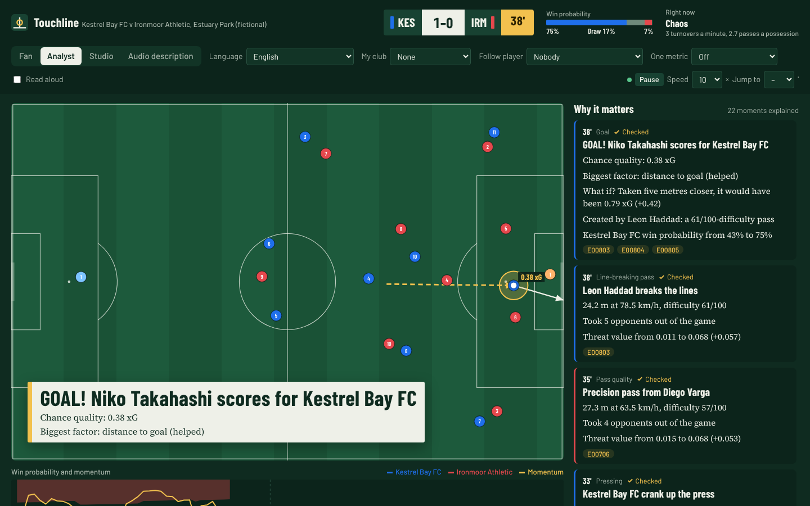
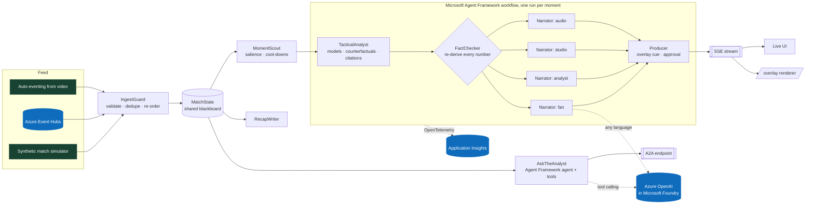

# Touchline

**The game, explained.** Touchline is an AI insights engine on Azure. It turns a live stream of
synthetic football events into explained moments, timed broadcast overlays and automated
recaps, and renders each one differently for every viewer.

Built for the Microsoft x Premier League *Inside the Game: Developer Hackathon*, for the
challenge *The Synthetic Match Insights Engine for Premier League Studio*. All data is
synthetic, and the clubs, players and venue are fictional.



- **Live demo:** `<your Container Apps URL>` (see [Deploy](#deploy-to-azure)). The project page is at `/story`, the live app at `/`, and the keyable overlay output at `/overlay`.
- **Demo video:** `<YouTube link>`
- **Submission kit:** [pitch and 2-minute video script](docs/SUBMISSION.md)

---

## What it does

| Stage the brief asks for | What Touchline does |
|---|---|
| **Ingest** | A seeded simulator generates a full 90-minute match: passes, carries, dribbles, shots, saves, tackles, interceptions, pressures, fouls, cards and corners, with a 22-player tracking snapshot on every event. The `IngestGuard` validates every message, drops duplicates and re-orders late events. It recovers a 10%-faulty feed exactly once. The same pipeline can consume **Azure Event Hubs** or events **auto-generated from video**. |
| **Interpret** | `MatchState` keeps an incremental model of the match: possession, xG, expected threat (xT), pass difficulty, progressive and line-breaking passes, PPDA, momentum, **control vs chaos**, game rhythm, live win probability, player speed and distance, records and ratings. |
| **Explain** | The `TacticalAnalyst` says **why** a moment matters, using glass-box models. It reports which factor drove a chance and a **counterfactual** ("taken five metres closer, it would have been 0.79 xG"). It covers the assist's difficulty, the build-up's threat, the win-probability swing, and finishing against expectation. Every claim is **cited to event IDs**, and the `FactChecker` re-derives every number before anything airs. |
| **Render** | The `Producer` emits **timed, machine-readable overlay cues** on the match clock (`touchline.overlay/1`), with layers, priorities, pitch anchors and multilingual copy. A **human-in-the-loop** producer console can approve each cue. There's a live broadcast UI, plus a clean, keyable `/overlay` output for a rendering partner. |
| **Personalise** | The same moment is written four ways: **Fan**, **Analyst**, **Studio** lower-third, and **Audio description** read aloud for blind and low-vision fans. It's available in **English, Spanish, French and Portuguese** offline, and any language through Azure OpenAI. Viewers can pick **a club**, **follow one player** (on-pitch highlight plus a live action ticker) or watch **one metric** (win probability, xG race, last pass difficulty, top speed, pressing or possession). |

It also covers the suggested features in the brief:

- **Player identification:** live name tags with speed indicators past a 28 km/h sprint threshold.
- **Pass quality:** distance, accuracy, and a 0 to 100 difficulty rating from a trained model.
- **Ball and shot speed.**
- **Auto-eventing from video:** a CV tracker turns pixels into passes and speeds.
- **Narratives, milestones and recaps.**
- **Explainability:** control vs chaos, pressing changes and rhythm.
- **Synthetic data innovation:** a simulator, a downloadable dataset and a model card.
- **Multilingual storytelling.**

## How it works



**Agents and their roles.**

| Agent | Role | Notes |
|---|---|---|
| `IngestGuard` | Front door for the feed | Pydantic contract, quarantine, exactly-once re-ordering, fault injection for demos |
| `MomentScout` | Decides what deserves airtime | Salience scores, per-kind cool-downs, sustained-pattern detectors (momentum, phase, pressing, rhythm) |
| `TacticalAnalyst` | Explains why it matters | Glass-box xG, pass and xT models; counterfactuals; evidence IDs on every claim |
| `FactChecker` | Nothing unverifiable airs | Recomputes xG, difficulty, speeds, distances and win probability from state. Rejects LLM text that has unsupported numbers or names in it. |
| `Narrator` x4 | Persona- and language-specific copy | Deterministic phrase banks. Optional Azure OpenAI rewrite or translation, always re-verified. |
| `Producer` | Graphics director | Layer scheduling, pre-emption, review mode, `touchline.overlay/1` cues |
| `RecapWriter` | Half-time and full-time recaps | Story detection (upset, comeback, late winner), turning points, control share, standouts |
| `AskTheAnalyst` | Q&A for fans, producers and other agents | Agent Framework agent with function tools. Answers are rejected if they contain numbers not in a tool result. Exposed over **A2A**. |

**Multi-agent design: what makes it more than a chain of prompts.**

- **A real workflow graph.** It's built with `WorkflowBuilder`: the analyst hands off to the fact-checker, which **fans out** to four narrators running concurrently in one superstep, which **fan in** to the producer. See `touchline/orchestrator.py`.
- **Shared state.** Every agent reads one `MatchState` blackboard. Messages along edges are typed (`Moment`, then the insight, then `NarrationResult[]`).
- **Failure recovery.** Each executor contains its own failures. A blocked insight never reaches air. Every LLM call goes through a timeout and a circuit breaker, which opens after three failures and falls back to verified phrase banks. A rejected LLM rewrite gets one corrective retry with the checker's feedback, then falls back. The live show never waits on a model.
- **Observability.** Every handoff is a span: visible live in the *Agents at work* tab, exportable as an audit trail, and sent to Application Insights through OpenTelemetry along with Agent Framework's own instrumentation.

## Explainable by construction

The models are trained on our own synthetic league. `scripts/fit_models.py` simulates 300
matches and holds out the last 20%:

| Model | Held-out AUC | Brier | Used for |
|---|---|---|---|
| xG, logistic on 6 shot features | 0.762 | 0.110 | Chance quality, factor attribution, counterfactuals |
| Pass completion, logistic on 9 features | 0.735 | 0.129 | Pass difficulty (0 to 100), passes over expected |
| xT, 16x12 value-iteration grid | n/a | n/a | Threat added by passes and carries, momentum |

They're logistic models on purpose, so every prediction breaks down into per-feature
contributions that the UI shows in the evidence drawer. The simulator's hidden scoring model
also uses player finishing skill, which xG deliberately leaves out. That makes "finishing above
expectation" a real, explainable signal. See [docs/MODEL_CARD.md](docs/MODEL_CARD.md).

## Evaluation

These results run in CI on every push (`python scripts/evaluate.py --matches 12 --gate`). They
cover 12 unseen matches, half of them through a 10% faulty feed.

| Metric | Result |
|---|---|
| Insights verified by the FactChecker | **100%** (671 of 671) |
| Goals explained | **100%** |
| Citations resolving to a real, non-future event | **0 errors** |
| Renders per insight (4 personas x 4 languages) | 16, **0 template leaks** |
| Agent pipeline per moment, p50 / p95 | **8 / 12 ms** (deterministic path) |
| Event to state update, p95 | **0.3 ms** |
| Faulty feed recovered exactly once and in order | **100%** |

Auto-eventing from video (`python -m touchline.vision.autoevent`) renders the first half as a
noisy 10 fps top-down feed (27,001 frames) and works out events from pixels alone. It
scored:

- pass precision **0.879**
- pass recall **0.747**
- passer and receiver both correct **89%**
- ball-speed error **2.14 km/h**
- shot recall **0.8**

Full numbers are in [docs/EVAL.md](docs/EVAL.md). The test suite also runs the real Agent
Framework LLM path against a mock OpenAI-compatible model. It checks that honest copy is
accepted and that a model which invents "99 goals" is rejected.

## Run it locally

```bash
pip install -r requirements.txt
uvicorn touchline.server:app --reload
# open http://localhost:8000
```

With no model configured it runs fully offline on verified phrase banks. To enable the LLM
agents, set one of the following:

```bash
# Azure OpenAI in Microsoft Foundry (API key, or managed identity / az login when the key is absent)
export AZURE_OPENAI_ENDPOINT=https://<resource>.openai.azure.com AZURE_OPENAI_MODEL=gpt-4.1-mini AZURE_OPENAI_API_KEY=...
# or a Foundry project through Agent Framework's FoundryChatClient
export FOUNDRY_PROJECT_ENDPOINT=https://<resource>.services.ai.azure.com/api/projects/<project> FOUNDRY_MODEL=gpt-4.1-mini
# or any OpenAI-compatible endpoint (e.g. Foundry Local)
export OPENAI_API_KEY=... OPENAI_BASE_URL=... OPENAI_MODEL=...
```

Other useful commands:

```bash
pytest -q                                             # 19 tests: sim, models, pipeline, ingest, API, A2A, mocked LLM
python scripts/evaluate.py --gate                     # evaluation gate (add --foundry for Azure AI groundedness scoring)
python -m touchline.vision.autoevent --minutes 5      # auto-eventing from video
python scripts/fit_models.py --matches 300            # regenerate the synthetic league and refit models
```

## Deploy to Azure

```bash
azd auth login
azd up            # provisions everything in infra/ and deploys the container
```

[`infra/`](infra) (Bicep) provisions:

- **Azure Container Apps**, with HTTP autoscaling, sticky sessions for live SSE, and health probes
- **Azure Container Registry**
- **Microsoft Foundry**: an AI Services account, a project, and a `gpt-4.1-mini` deployment, with local auth disabled
- **Azure Event Hubs**, for event-driven ingestion
- **Log Analytics and Application Insights**
- a **user-assigned managed identity** with least-privilege roles: AcrPull, Cognitive Services OpenAI User, Azure AI User, Event Hubs sender and receiver

There are no secrets anywhere. The app authenticates to the model and the hub with its identity.

Event-driven mode: `python scripts/publish_feed.py --seed 42 --speed 10` plays a match onto
Event Hubs. The deployed app consumes it as session `live`, at `<url>/?session=live`.

## Interfaces

- `GET /api/matches/{session}/stream` is the live SSE stream: events, state, insights, cues and agent traces.
- `GET /api/matches/{session}/insights?persona=&lang=`, `/recap`, `/players`, `/events/{id}` (facts, model drivers, pitch control), `/audit`, and `/dataset.jsonl`.
- `POST /api/matches` starts a new seeded match (optionally with a faulty feed). `POST /api/matches/{session}/control` handles pause, speed, jump, review mode and languages. `POST /api/matches/{session}/ask` is the Q&A endpoint.
- [Overlay contract](docs/OVERLAY_CONTRACT.md). The `/overlay` page is a keyable reference renderer.
- **A2A**: agent card at `/.well-known/agent-card.json`, JSON-RPC at `/a2a`.

## Repository layout

```
touchline/
  sim/            synthetic match engine (spatial possession model, fatigue, game state)
  analytics/      glass-box models, fitted params, incremental MatchState, win probability, pitch control
  agents/         IngestGuard, MomentScout, TacticalAnalyst, FactChecker, Narrator, Producer, RecapWriter, AskTheAnalyst
  orchestrator.py Microsoft Agent Framework workflow (fan-out / fan-in) + tracing
  runtime.py      live match session, pacing, controls, SSE bus
  llm.py          Foundry / Azure OpenAI / OpenAI-compatible clients via Agent Framework, circuit breaker
  a2a.py          A2A server (a2a-sdk)
  feeds.py        Azure Event Hubs producer / consumer
  vision/         auto-eventing from rendered video
  i18n.py         en / es / fr / pt phrase banks
web/              live UI, project story page, overlay renderer (no build step), self-hosted OFL fonts
infra/            Bicep for azd
scripts/          model fitting, evaluation gate, Event Hubs publisher
tests/            pytest suite
docs/             model card, evaluation, overlay contract, submission kit
```

## Rules and data

- Every event comes from a seeded simulator. No real match data, clubs, players, marks or
  broadcast footage are used.
- Club and player names are invented. Fonts are SIL OFL, and their licences are in `web/fonts/`.
- The project was created during the hackathon period, from September 29, 2026.

## License

MIT
