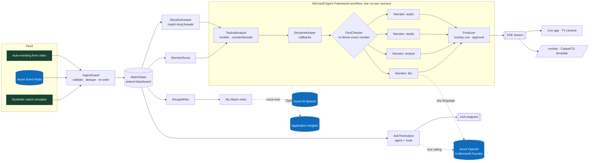

# Touchline

**The game, explained.** Touchline is an AI insights engine on Azure. It turns a live stream of
football events into explained moments, storylines that run across the whole match, timed
broadcast graphics, automated recaps and personal highlight reels. Each one is rendered
differently for every viewer, and every number is checked before it airs.

Built for the Microsoft x Premier League *Inside the Game: Developer Hackathon*, for the
challenge *The Synthetic Match Insights Engine for Premier League Studio*. All data is
synthetic, and the clubs, players and venue are fictional.


- **Live demo:** `<your Container Apps URL>` (see [Deploy](#deploy-to-azure)). The live app is at `/`, the project page at `/story`, and the keyable graphics output at `/overlay`.
- **Demo video:** `<YouTube link>`
- **For broadcasters:** [workflow fit, latency budget, trust and cost per match](docs/BROADCASTERS.md)
- **Submission kit:** [pitch and 2-minute video script](docs/SUBMISSION.md)

---

## What it does

| Stage the brief asks for | What Touchline does |
|---|---|
| **Ingest** | A seeded, calibrated simulator generates a full 90-minute match (about 2.4 goals, 23 shots and 1,100 passes per game): passes, carries, dribbles, shots, saves, tackles, interceptions, pressures, fouls, cards and corners, with a 22-player tracking snapshot on every event. The `IngestGuard` validates, de-duplicates and re-orders the feed, and repaired a 10%-faulty feed exactly once in every evaluation match. The same pipeline consumes **Azure Event Hubs** or events **auto-generated from video**. |
| **Interpret** | `MatchState` keeps a live model of the match: possession, xG, expected threat (xT), pass difficulty, progressive and line-breaking passes, PPDA, momentum, **control vs chaos**, game rhythm, win probability (stoppage time included), player speed and distance, records and ratings. |
| **Explain** | The `TacticalAnalyst` says **why** a moment matters: which factor drove a chance, a **counterfactual** ("taken five metres closer, it would have been 0.79 xG"), the assist's difficulty, the build-up's threat and the win-probability swing. The `StorylineKeeper` remembers the whole match and adds **callbacks**: "it began with a loss of possession by Varga, 24 seconds earlier", then later "redemption for Varga". Every claim cites event IDs, and the `FactChecker` re-derives every number, story counts included, before anything airs. |
| **Render** | The `Producer` emits **timed, machine-readable cues** on the match clock (`touchline.overlay/1`) with layers, priorities and copy in every language. A producer can approve each one. The live app has a **broadcast TV camera** view, a keyable `/overlay` output, and a **CasparCG / SPX-compatible graphics template** that real playout systems can load. |
| **Personalise** | Every moment is written four ways: **Fan**, **Analyst**, **Studio** lower-third and **Audio description** for blind and low-vision fans, with a neural voice via Azure AI Speech. It works in **English, Spanish, French and Portuguese** offline, and in any language through Azure OpenAI. Viewers can pick **their club (or both)**, star **any number of favourite players**, switch on **player focus** to follow one player all match, or watch **one metric**. After the match, **My Match** cuts each fan a personal highlights reel: their clubs, their players, their language. |

Everything else in the brief is covered too:

- **Player identification:** live name tags with speed indicators past a 28 km/h sprint threshold.
- **Pass quality:** distance, accuracy, and a 0 to 100 difficulty rating from a trained model.
- **Ball and shot speed.**
- **Auto-eventing from video:** pass and speed metrics generated from pixels.
- **Narratives, milestones and recaps** that find the story: comeback, ten men, late winner, hat-trick.
- **Explainability:** control vs chaos, pressing changes and game rhythm.
- **Synthetic data innovation:** a downloadable dataset and a model card.
- **Multilingual storytelling.**

## The demo match

The live demo replays match 221: **Kestrel Bay FC 3-2 Ironmoor Athletic**. Kestrel go down to ten
men in the 29th minute, fall behind, and sink to 2% win probability before Ravi Varga completes
his hat-trick in the 94th minute. Varga's own loss of possession had led to Ironmoor's first goal.
`scripts/find_demo_seed.py` found it by scoring 400 simulated matches for drama.

## How it works



**Agents and their roles.**

| Agent | Role | Notes |
|---|---|---|
| `IngestGuard` | Front door for the feed | Pydantic contract, quarantine, exactly-once re-ordering, fault injection for demos |
| `MomentScout` | Decides what deserves airtime | Salience scores, cool-downs, sustained-pattern detectors (momentum, phase, pressing, rhythm) |
| `StorylineKeeper` | Match-long memory | Threads (duels, overloaded flanks, keepers, wasteful finishing, fatigue, costly errors, comebacks, ten men); writes callbacks; independently recounts its own numbers for the checker |
| `TacticalAnalyst` | Explains why it matters | Glass-box xG, pass and xT models; counterfactuals; evidence IDs on every claim |
| `FactChecker` | Nothing unverifiable airs | Recomputes every number from the raw events; blocks future citations; rejects LLM text with unsupported numbers or names |
| `Narrator` x4 | Persona- and language-specific copy | Verified phrase banks; optional Azure OpenAI rewrite or translation, always re-checked, delivered off the hot path |
| `Producer` | Graphics director | Layer scheduling, pre-emption, review mode, `touchline.overlay/1` cues |
| `RecapWriter` | Half-time and full-time recaps | Story detection, turning points, the storylines that aired, standouts |
| `AskTheAnalyst` | Q&A for fans, producers and other agents | Agent Framework agent with function tools; answers rejected if numbers aren't in a tool result; exposed over **A2A** |

**Multi-agent design: what makes it more than a chain of prompts.**

- **A real workflow graph.** Built with `WorkflowBuilder`: analyst, then storyline, then fact-checker, which **fans out** to four narrators in one superstep, which **fan in** to the producer. See `touchline/orchestrator.py`.
- **Memory that matters.** The StorylineKeeper carries state across the whole match, so commentary can call back to minute 36 in minute 76.
- **Agents that check each other.** The FactChecker found two real bugs during development. One was a comeback line citing an event from the future during fast replay. The other was a duel story that named two different players who shared a name. In both cases the insight was blocked instead of aired, and the root cause was fixed.
- **Failure recovery.** Executors contain their own failures. LLM calls sit behind a timeout and a circuit breaker and fall back to verified copy. Analysis runs in step with the feed, so it can never read the future, and slow language-model work arrives later as an update.
- **Observability.** Every handoff is a span: live in the *Agents at work* tab, exportable as an audit trail, and sent to Application Insights through OpenTelemetry with Agent Framework's own instrumentation.

## Explainable by construction

The models are trained on our own synthetic league. `scripts/fit_models.py` simulates 300
matches and holds out the last 20%:

| Model | Held-out AUC | Brier | Used for |
|---|---|---|---|
| xG, logistic on 6 shot features | 0.762 | 0.110 | Chance quality, factor attribution, counterfactuals |
| Pass completion, logistic on 9 features | 0.735 | 0.129 | Pass difficulty (0 to 100), passes over expected |
| xT, 16x12 value-iteration grid | n/a | n/a | Threat added by passes and carries, momentum |

They're logistic models on purpose: every prediction breaks down into per-feature
contributions, which the evidence drawer shows. See [docs/MODEL_CARD.md](docs/MODEL_CARD.md).

## Evaluation

Runs in CI on every push (`python scripts/evaluate.py --matches 12 --gate`), on 12 unseen
matches, half of them through a 10% faulty feed. Full report: [docs/EVAL.md](docs/EVAL.md).

| Metric | Result |
|---|---|
| Insights verified by the FactChecker | **100%** (735 of 735) |
| Goals explained | **100%** |
| Citations resolving to a real, non-future event | **0 errors** |
| Renders per insight (4 personas x 4 languages) | 16, **0 template leaks** |
| Agent pipeline per moment, p50 / p95 | **2.9 / 4.8 ms** (inside one 20 ms broadcast frame) |
| Event to state update, p95 | **0.5 ms** |
| Faulty feed recovered exactly once and in order | **100%** |

From video:

- **Top-down feed:** pass precision 0.88, recall 0.75, passer and receiver correct 89%, ball-speed error 2.1 km/h, shot recall 0.8.
- **Broadcast camera:** player localisation within 0.43 m (median) over 17,000 detections. Pass detection from the angled view is experimental, and the report says why.

There are **26 tests**. They include the real Agent Framework LLM path against a mock model, checking that a model which invents "99 goals" is rejected. They also check that tampered story numbers are blocked and that no insight uses information from its future.

## Run it locally

```bash
pip install -r requirements.txt
uvicorn touchline.server:app --reload
# open http://localhost:8000
```

With no cloud services configured it runs fully offline on verified phrase banks with the
browser's voice. To enable the cloud agents:

```bash
# Azure OpenAI in Microsoft Foundry (API key, or managed identity / az login when the key is absent)
export AZURE_OPENAI_ENDPOINT=https://<resource>.openai.azure.com AZURE_OPENAI_MODEL=gpt-4.1-mini AZURE_OPENAI_API_KEY=...
# or a Foundry project through Agent Framework's FoundryChatClient
export FOUNDRY_PROJECT_ENDPOINT=https://<resource>.services.ai.azure.com/api/projects/<project> FOUNDRY_MODEL=gpt-4.1-mini
# neural voice (key, or AZURE_SPEECH_RESOURCE_ID for managed identity)
export AZURE_SPEECH_REGION=<region> AZURE_SPEECH_KEY=...
```

Other useful commands:

```bash
pytest -q                                          # 26 tests
python scripts/evaluate.py --gate                  # evaluation gate (add --foundry for Azure AI groundedness scoring)
python -m touchline.vision.autoevent --minutes 5   # auto-eventing from the top-down feed
python -m touchline.vision.broadcast_cv            # computer vision from the broadcast camera
python scripts/find_demo_seed.py --seeds 400       # find the most dramatic match
python scripts/fit_models.py --matches 300         # regenerate the synthetic league and refit models
```

## Deploy to Azure

```bash
azd auth login
azd up            # provisions everything in infra/ and deploys the container
```

[`infra/`](infra) (Bicep) provisions:

- **Azure Container Apps**, with HTTP autoscaling, sticky sessions and health probes
- **Azure Container Registry**
- **Microsoft Foundry**: an AI Services account, a project, and a `gpt-4.1-mini` deployment, with local auth disabled
- **Azure AI Speech**, through the same AI Services account
- **Azure Event Hubs**, for event-driven ingestion
- **Log Analytics and Application Insights**
- a **user-assigned managed identity** with least-privilege roles

There are no secrets anywhere. Event-driven mode: `python scripts/publish_feed.py --seed 42 --speed 10`
plays a match onto Event Hubs, and the app serves it as session `live` at `<url>/?session=live`.

## Interfaces

- **Stream:** `GET /api/matches/{session}/stream` (SSE): events, state, insights, cues, late renders and agent traces.
- **Read endpoints:** `GET /insights?persona=&lang=`, `/recap`, `/players`, `/events/{id}` (facts, model drivers, pitch control), `/audit`, `/dataset.jsonl`.
- **My Match:** `GET /reel?club=home|away|both&player=h9,a7&lang=` returns the edit list; `POST /reel` renders the MP4.
- **Voice:** `GET /api/speak?text=&lang=`.
- **Graphics:** the [overlay contract](docs/OVERLAY_CONTRACT.md). `web/templates/touchline-graphics.html` loads in **CasparCG** (`play`, `stop`, `next`, `update`) and **SPX Graphics Controller**, or runs live with `?live=1`.
- **A2A:** agent card at `/.well-known/agent-card.json`, JSON-RPC at `/a2a`.

## Design

One design system across the app, the on-air graphics, the reels and the story page, with broadcast safe areas, motion timings and computed contrast. It's our own; no league or club marks are used. See [docs/DESIGN.md](docs/DESIGN.md).

## Repository layout

```
touchline/
  sim/            synthetic match engine (spatial possession model, fatigue, game state)
  analytics/      glass-box models, fitted params, incremental MatchState, win probability, pitch control
  agents/         IngestGuard, MomentScout, StorylineKeeper, TacticalAnalyst, FactChecker, Narrator, Producer, RecapWriter, AskTheAnalyst
  orchestrator.py Microsoft Agent Framework workflow (fan-out / fan-in) + tracing
  runtime.py      live match session, pacing, controls, SSE bus
  highlights.py   My Match: reel planning (EDL) and rendering
  vision/         broadcast camera, top-down and broadcast-angle auto-eventing
  llm.py          Foundry / Azure OpenAI / OpenAI-compatible clients via Agent Framework, circuit breaker
  speech.py       Azure AI Speech neural voice
  a2a.py          A2A server (a2a-sdk)
  feeds.py        Azure Event Hubs producer / consumer
  i18n.py         en / es / fr / pt phrase banks
web/              live app, story page, overlay output, CasparCG/SPX template, self-hosted OFL fonts
infra/            Bicep for azd
scripts/          model fitting, evaluation gate, demo-seed search, Event Hubs publisher
tests/            pytest suite
docs/             evaluation, model card, overlay contract, broadcasters, design system, submission kit
```

## Rules and data

- Every event comes from a seeded simulator. No real match data, clubs, players, marks or
  broadcast footage are used.
- Club and player names are invented. Fonts are SIL OFL; their licences are in `web/fonts/`.
- The project was created during the hackathon period, from September 29, 2026.

## License

MIT
