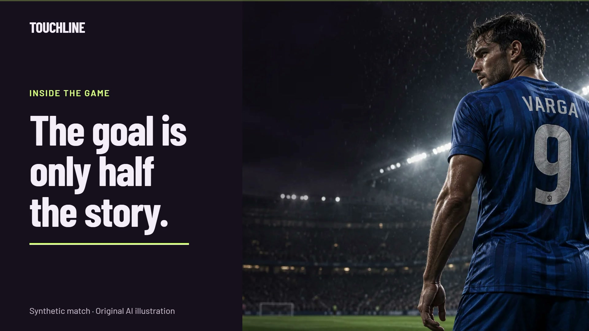
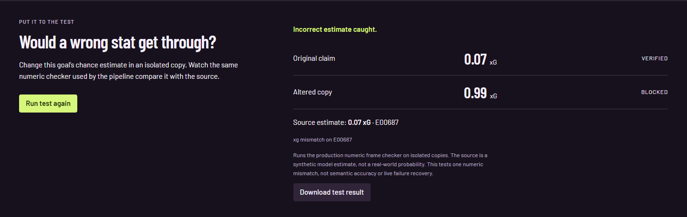
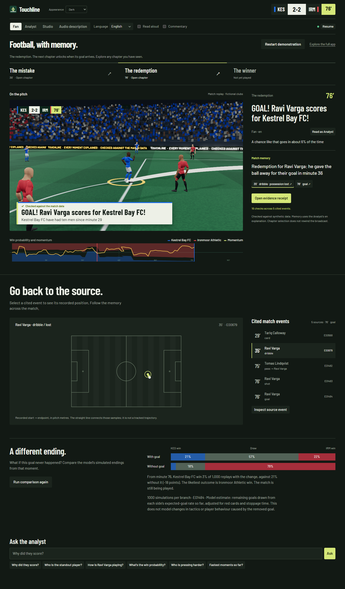

<div align="center">



# Touchline

**Football, with memory. Watch the story. Follow the evidence.**

A Microsoft Agent Framework system that turns synthetic football events into match-long stories,
personalized graphics and broadcaster-oriented cue contracts. Built for the Microsoft × Premier League
*Inside the Game* hackathon.

[](https://github.com/likalight/touchline/actions/workflows/ci.yml)
[](LICENSE)


[Open the live demo](https://ca-touchline-3a2uvrfhbicqc.livelytree-3fdb8286.southeastasia.azurecontainerapps.io/judge) · [Run locally](#try-the-90-second-demo) · [Evidence](#what-we-have-measured) · [Architecture](#how-it-works) · [Deploy](#deploy-to-azure) · [Category case](docs/WINNING_CASE.md)

</div>

## Evidence at a glance

| Status | What a judge can verify | Boundary |
|---|---|---|
| Implemented | Isolated three-chapter replay, player context, source inspection, audience comparison and JSON receipts | Synthetic data and model estimates; not real broadcast footage |
| Observed on the current deployed build | Source-selected hosted answer, explicit false-premise fallback, healthy/ready service, 198 restored acknowledged IDs, ten external snapshot-reconnect checks and six MCP checks | [Dated source/image proof](docs/DEPLOYMENT_PROOF.md); three bounded application answers passed (one hosted selection, two fallbacks); earlier package, streaming and film evidence retains its build |
| Reproducible locally / CI | Python, JS contracts, real browser journeys, deterministic pipeline gate, source/model fingerprints | Tests cover specific cases; they do not establish universal truth |
| Measured bounded model runs | Earlier version-4 six-case run and disclosed zero-call oracle correction; latest three application checks passed with one accepted hosted selection and two fallbacks; 12-output narration contract comparison | [Raw cases and scope](docs/FOUNDRY_EVAL.md); no broad accuracy, language or superiority claim |
| Needs further evidence | Portal-quality evaluation, equivalent-budget end-to-end agent comparison, real operator/user benefit and accessibility evaluation | See [Foundry status](docs/FOUNDRY_EVAL.md), [comparison](docs/AGENT_COMPARISON.md) and [impact](docs/IMPACT.md) |
| Submission gate | Verified 115-second Brag film is ready, with nine fresh UI scenes from `706f4f32` | Public accepted-host URL and submission receipt remain unconfirmed |

**Our strongest current category evidence is Azure Cloud Native Integration.** Agent Framework
orchestrates specialised components; many are deterministic by design. GitHub Actions tests
and builds the project and is distinct from GitHub Copilot Agent Mode. [Category evidence](docs/WINNING_CASE.md).

[Read the disposition of all 37 audit findings](docs/READINESS.md): implemented changes,
measured checks and the remaining human, submission and production evidence. The
[28 October fresh audit](docs/FRESH_AUDIT.md) separates evidence readiness for each judging
criterion and category from unsupported winning predictions.

## Start with one story

The default app at **`/`** is the match centre: a live tactical pitch, a prominent goal story,
and a timeline that lets you revisit goals while the broadcast continues. Personalise the
view, inspect the evidence, or explore Q&A, players, alternate endings and production tools.
The same light/dark appearance follows you into Judge Mode, the phone companion and the reel.
Read the [main-app redesign and validation report](docs/MATCH_CENTRE.md).

**Player Spotlight** gives all 22 fictional players an identity, squad number,
timestamped match totals and inspectable moments. Select a player to explore their story,
then follow them on the pitch with a persistent name and shirt-number label. The camera
keeps the action ahead of a quieter stadium, and the compact opening brings the pitch
into view sooner. Statistics use only snapshots delivered to the browser; inspecting an
earlier moment does not rewind the pitch or turn current totals into historical facts.

The judge entrance now leads with an original AI illustration of Kofi Varga. That illustration
is shown only for this fictional player; other roster members have their own number treatment.
The replay brings match memory before supporting statistics, and the receipt labels its
verification result as **source checks passed**. See the [27 October visual and readiness audit](docs/VISUAL_DIAGNOSIS.md).

**Active-roster fix:** dismissed players are removed from actions, tracking, restarts and the pitch display. Formation roles stay stable; an active outfielder replaces a dismissed goalkeeper. Regression tests cover the former seed-221 failure. Judge Mode now uses verified seed 87: mistake at 28′, redemption at 44′, winner at 90′.

A mistake leads to a goal. The same player returns to score. Then comes the winner.
Touchline remembers the earlier moment and explains the connection. A fan gets the story;
an analyst gets the tactical evidence; a producer gets a timed graphics cue.

**Judge Mode** (`/judge`) takes you through three excerpts in 90 seconds. Each visitor owns
an isolated replay with pause, refresh and restart. **Match memory** puts the explanation
beside the pitch, with three chapters that unlock as their goals arrive:

- revisit a goal without interrupting the live replay, or follow the latest chapter;
- switch between Fan and Analyst explanations in place;
- follow the redemption back to the earlier loss of possession on an evidence map;
- ask what changes without the selected goal, using 1,000 model simulations per branch.

The matchday presentation supports light, dark and system themes, keyboard navigation,
reduced motion and mobile layouts. Its original generated hero is clearly labeled;
the interactive pitch and evidence map use the synthetic match data. See the
[design audit and local performance results](docs/MATCH_CENTRE.md).

Open **Evidence receipt** to:

- compare Fan and Analyst versions of the same moment;
- inspect cited events, model factors and original verification results;
- follow the recorded agent handoffs and editorial decision;
- download the complete receipt as JSON.

In Judge Mode, **Try an incorrect stat** changes one chance estimate in an isolated copy.
The real numeric checker compares the original and altered claims with the source; download
its observed verdict. This is a bounded numeric test, with the match and receipt unchanged.
The separate [recorded recovery evidence](docs/evidence/recovery.json) exercises four actual
local pipeline faults. Neither demonstration substitutes for hosted Azure recovery testing.



All clubs, players, events and venues are fictional. Verification is against synthetic
facts and model estimates; it is not a guarantee of semantic accuracy, translation quality,
or correctness on a real football feed.

The map uses recorded event coordinates. Lines join recorded endpoints, not tracked ball
trajectories. Alternate endings are model estimates, not predictions of what really would happen.



## Try the 90-second demo

Requires Python 3.12+. No Azure subscription or model key is needed for the built-in demo.

```bash
python -m venv .venv
# macOS/Linux: source .venv/bin/activate
# Windows PowerShell: .venv\Scripts\Activate.ps1
pip install -r requirements.txt
uvicorn touchline.server:app --reload
```

Open the [match centre](http://localhost:8000/) for the full experience, or
[Judge Mode](http://localhost:8000/judge) for the guided story. Select **Start demonstration**, then open a
chapter after a goal. Compare perspectives, select a memory link, and try the alternate ending.
Open its receipt to inspect the checks and download the proof. The full app at
[localhost:8000](http://localhost:8000) adds player focus, four built-in languages, commentary,
recaps, counterfactuals, a phone view and personalized highlights.

**Live on Azure:** [open Judge Mode](https://ca-touchline-3a2uvrfhbicqc.livelytree-3fdb8286.southeastasia.azurecontainerapps.io/judge). Build `706f4f32` is deployed with Foundry version 4. A hosted score answer selected exact source statements without fallback; an irrelevant false-premise selection was safely rejected. The external snapshot-reconnect probe passed ten checks, and MCP passed six. The outbox restored 198 acknowledged IDs. All three bounded post-deployment application answers passed: one accepted hosted selection and two explicit deterministic fallbacks, including the checked Varga recovery story. [Current source/image evidence](docs/DEPLOYMENT_PROOF.md) keeps the earlier Functions package, external streaming test, film capture and mid-match recovery experiments tied to their actual builds. These observations do not establish an SLA or human usefulness.

## What we have measured

| Evidence | What it establishes | What it does not establish |
|---|---|---|
| [12-match protocol](docs/EVAL.md) and [deployed-revision CI results](docs/evidence/audit-pipeline-evaluation.json) | Verification, goal coverage, citations, rendering and server pipeline timing on held-out synthetic matches | Real-match accuracy, browser latency, model quality or human usefulness |
| [Specialist ablation](docs/ABLATION.md) | Effects of removing the ingest guard, scout, storyline, checker and editorial scheduler | A head-to-head comparison against a capable single-agent system |
| [Frozen-model check](docs/FROZEN_MODEL_EVAL.md) | Unchanged logistic models evaluated on fresh corrected synthetic matches, with calibration bins and fingerprints | Real-match generalisation, xT validation or a new training run |
| [Single-agent narration comparison](docs/AGENT_COMPARISON.md) | 12 actual model outputs, raw failures and a disclosed scorer correction applied to both alternatives | Semantic accuracy, statistical superiority or an end-to-end agent-count comparison |
| [Load experiment](docs/LOADTEST.md) | A historical 30-second, co-located streaming experiment | Full-match capacity, multi-replica operation or an Azure SLA |
| [External cloud streaming](docs/CLOUD_SOAK.md) | All 12 attempted clients received all 1,923 ordered events and the correct 1–1 finish in one accelerated match, over 206.68 seconds | Maximum capacity, sustained real-time match-length availability, reconnect or end-to-end latency |
| [Dated cloud execution](docs/DEPLOYMENT_PROOF.md) and [prior-build package](docs/evidence/readiness-stored-package.json) | Final-image hosted source selection and ledger restoration; earlier Functions package from stored input replay | Exactly-once external effects, restart-failure recovery of this outbox, production SLA or human validation |
| [Version-4 bounded Foundry run](docs/FOUNDRY_EVAL.md) | Six fixed hosted cases passed stronger score/player/citation/record-scope checks; all raw outputs retained | General answer quality, multilingual parity or a completed portal evaluation |
| [Final live fallback and isolation checks](docs/DEPLOYMENT_PROOF.md) | Varga recovery returns a checked story with three citations after rejecting unbound model prose; one private match retains its package without shared output | A hosted-answer success for that fallback, universal relevance or distributed tenant isolation |
| [Final film validation](docs/FINAL_VIDEO.md) | 115-second Brag film with nine fresh deployed `706f4f32` UI scenes; 18/18 sampled contrast checks, full decode and captions passed | Public video hosting, completed hackathon submission or full accessibility certification |
| [CI](https://github.com/likalight/touchline/actions/workflows/ci.yml) | Automated tests, evaluation gate, Bicep build and container smoke checks | Successful provisioning in a particular Azure subscription |
| [Match memory browser journey](tests/story-browser.cjs) | Full replay, navigation, original-event map, audience switching, stale-request isolation, downloads and responsive layouts | A human usability study or cross-browser accessibility certification |

CI uploads the measured evaluation JSON and report as an artifact tied to its commit.
[Current code CI](https://github.com/likalight/touchline/actions/runs/40630150457) passed
223 Python tests, 11 JavaScript contracts and all four jobs, including story, match-centre and resilience browser journeys, at `706f4f32`.
Four required checks (`test`, `browser`, `bicep`, `docker`) gate merges, including administrators.
Auto-merge is enabled and waits for those checks; consult the run for the submitted revision.
Receipts preserve the checks performed at the original moment; opening one does not rerun
verification against the later match state. Server pipeline timing excludes model rewrites,
speech and browser delivery.

## How it works

```mermaid
flowchart LR
  A[Synthetic events] --> B[IngestGuard]
  B --> C[MomentScout]
  C --> D[TacticalAnalyst]
  D --> E[StorylineKeeper]
  E --> F[FactChecker]
  F --> G[Four audience narrators]
  G --> H[Producer]
  H --> I[Timed graphics + evidence receipts]
  I --> J[Event Hubs]
  J --> K[Azure Functions]
  K --> L[Blob packages + social cards]
```



The graph uses Microsoft Agent Framework executors, shared match state and fan-out/fan-in.
The analyst calculates interpretable xG, pass difficulty, threat and win-probability changes.
The storyline specialist tracks callbacks across the match. The checker independently
re-derives supported claims. The producer scores competing moments and explains what airs.
A supervisor and resilience drills exercise recovery when a specialist fails.

The core analytical specialists are deterministic executors, not separate language models.
Foundry provides the hosted, tool-using **Ask the analyst** agent and model-backed narration.
The four built-in languages (EN/ES/FR/PT) use phrase banks. Other languages require the model
and should be checked by fluent speakers. The answer panel distinguishes hosted execution
from local fallback using evidence from that particular request.

<details>
<summary><strong>Explore the full experience</strong></summary>

- **Football intelligence:** xG, xT, PPDA, pass difficulty, momentum, control/chaos, speed and distance.
- **Storytelling:** goal explanations, mistakes and redemption, milestones, recaps and two-voice commentary.
- **Personalization:** Fan, Analyst, Studio and Audio description; clubs, players, language and a chosen metric.
- **Broadcast:** timed overlay contract, producer review, CasparCG/SPX graphics template and evidence export.
- **Experiments:** counterfactual simulations, synthetic video auto-eventing, personal 3D highlights and a phone second screen.
- **Integration:** A2A endpoint, nine MCP tools, Event Hubs and Functions-generated packages.

The video detector has measured limitations: see [evaluation](docs/EVAL.md). Audio description
is implemented; accessibility and usability with real participants remain to be validated.

</details>

## Deploy to Azure

Requires Azure CLI, Azure Developer CLI, a subscription with model quota, and permissions
to create resources and role assignments. Deployment creates billable resources.

```bash
azd auth login
azd env new touchline-demo
azd up
```

Bicep provisions Container Apps, Foundry, managed identity, monitoring, Event Hubs, Functions
and Blob Storage. Agent publication is a required provisioning hook: missing configuration
or missing agent versions fails the command. Deployment configuration supports Microsoft
Entra ID producer roles; see [governance](docs/GOVERNANCE.md).

After deployment, test a real hosted agent request and save the observed result:

```bash
python scripts/smoke_deployment.py https://YOUR_APP --output evidence/cloud-smoke.json
```

The command makes a billable model request. It rejects offline/router answers and fallback
execution. To verify the downstream chain for a published, completed synthetic match, add
`--match-id SYN-00087` using the exact match ID returned by your feed. The full procedure,
recovery drill and result requirements are in [DEPLOYMENT_PROOF.md](docs/DEPLOYMENT_PROOF.md).

### Reliability boundaries

- **One warm replica.** Browser sessions remain in memory; scaling out requires shared session state. Judge replays expire after 15 minutes and do not publish broadcast outputs.
- **One active input match on partition 0.** A Blob journal stores current match history and the Event Hubs resume offset atomically. ETag conflicts stop competing writers. With a durable outbox, replay reconciles missing outputs against acknowledged IDs; without it, historical outputs are suppressed. The journal alone does not provide distributed ownership or atomic input-to-output delivery.
- **Configured durable outbound.** The current Azure build uses `TOUCHLINE_OUTBOX_URL`: pending messages and acknowledgements use a single-writer Blob ledger, with 198 acknowledged IDs restored after the final normal application update. Delivery is at least once with stable IDs; consumers must deduplicate. Without that setting, the development queue is process memory. Crash-between-send-and-ack recovery remains a separate live experiment; [scope and capacity](docs/READINESS.md#durable-delivery-scope).
- **Stable full-time packages.** Events carry the completed package snapshot, so Functions does not depend on a mutable `live` or `demo` session. Duplicate delivery writes the same package key. Teams notifications remain best-effort and may repeat.
- **Isolated failure drills.** A model-outage drill affects its own match, without disabling other viewers' model access. Failed input ingestion reports degraded health and fails the readiness probe.
- **Protected shared playback.** Anonymous viewers can run their own Judge Mode. Shared production controls require the configured producer role; without Entra, deployed shared controls stay read-only.

## Run the checks

```bash
pip install -r functions/requirements.txt pytest
pytest -q
python scripts/evaluate.py --matches 12 --gate --json-out docs/evidence.json
python scripts/ablation.py --matches 12
python scripts/compare_agents.py --prepare --limit 12 --output evidence/comparison-inputs.json
```

The comparison preparation is offline. Live Foundry evaluation, additional-language checks,
load/soak testing and human user tests are separate evidence steps, not implied passes.

## Interfaces

| Interface | Entry point |
|---|---|
| Judge replay | `/judge`, `POST /api/judge`; control token belongs to the creating viewer |
| Evidence receipt | `GET /api/matches/{session}/insights/{id}/receipt?persona=analyst&lang=en` |
| Match data | `/api/matches/{session}` with `/insights`, `/recap`, `/players`, `/audit`, `/dataset.jsonl` |
| Streaming | `/api/matches/{session}/stream` (SSE); `/overlay` for timed graphics |
| Analyst | `POST /api/matches/{session}/ask` with per-request execution provenance |
| Downstream output | `/api/downstream`, `/api/matches/{session}/package` |
| Agent integration | `/.well-known/agent-card.json`, `/a2a`, `/mcp` |

## Documentation

| Document | Purpose |
|---|---|
| [Category case and gap register](docs/WINNING_CASE.md) | Evidence, next steps and limits for every prize |
| [Deployment proof](docs/DEPLOYMENT_PROOF.md) | Capture live Foundry, integration and recovery evidence |
| [Agent comparison](docs/AGENT_COMPARISON.md) | Baselines, fairness and scoring limits |
| [Submission and video](docs/SUBMISSION.md) | Focused project pitch and a sub-two-minute demo |
| [Evaluation](docs/EVAL.md) · [Ablation](docs/ABLATION.md) · [Load](docs/LOADTEST.md) | Measured results with scope |
| [Foundry](docs/FOUNDRY.md) · [Governance](docs/GOVERNANCE.md) | Agent management, controls and limitations |
| [Broadcasters](docs/BROADCASTERS.md) · [Overlay contract](docs/OVERLAY_CONTRACT.md) | Integration and adoption |
| [Impact](docs/IMPACT.md) · [User test](docs/USER_TEST.md) | Pilot goals and human validation protocol |
| [Model card](docs/MODEL_CARD.md) · [Design](docs/DESIGN.md) | Synthetic models and design system |

Licensed under [MIT](LICENSE). Third-party assets retain their documented licenses. This is
an independent hackathon entry; no prize, endorsement or production certification is claimed.
